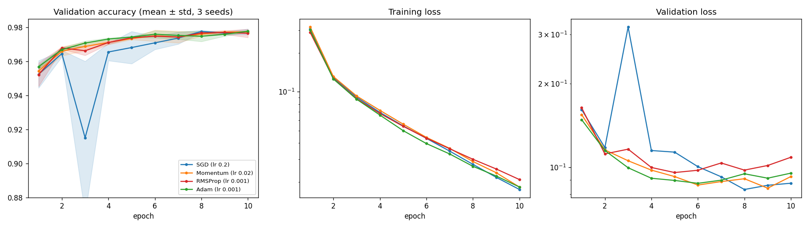
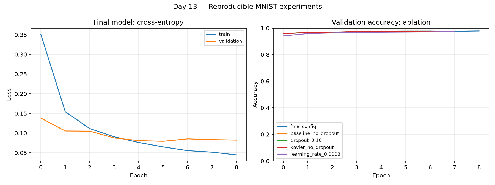
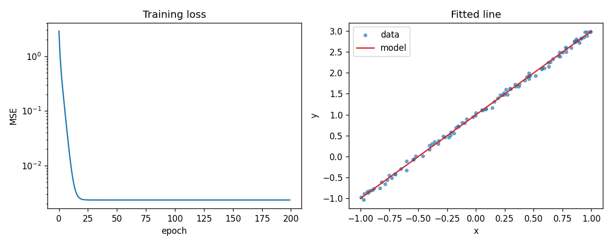
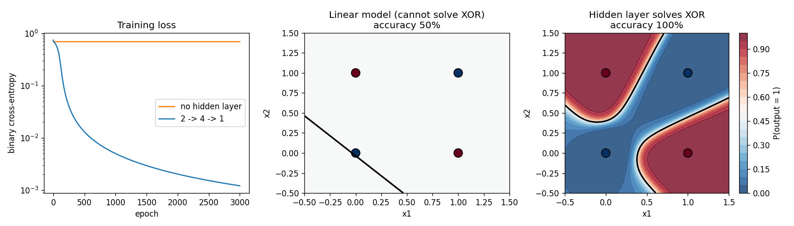
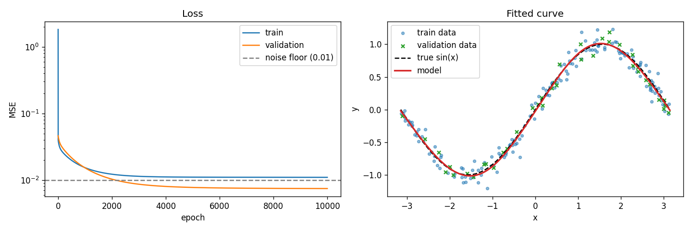
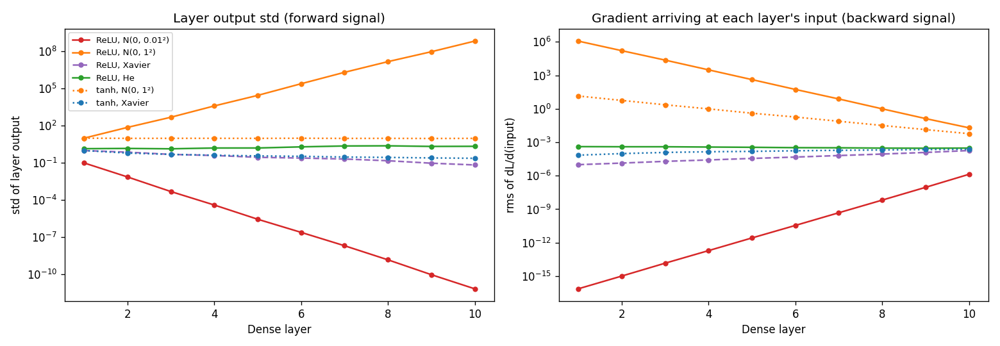
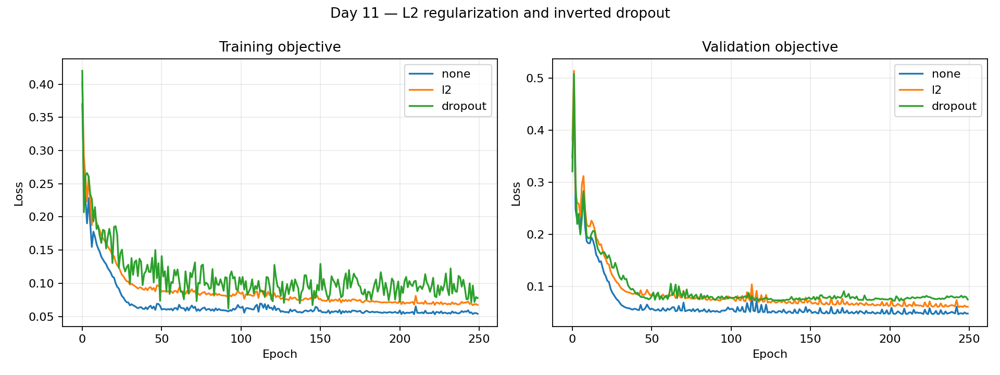
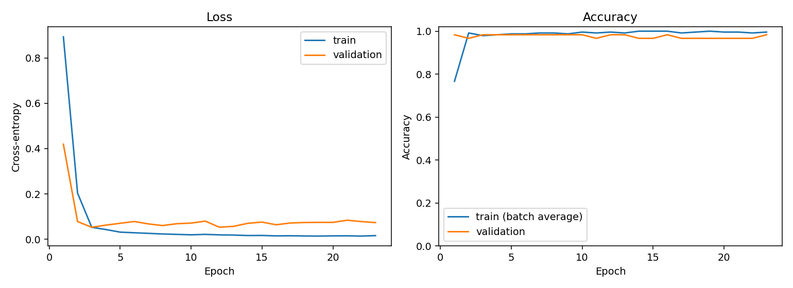
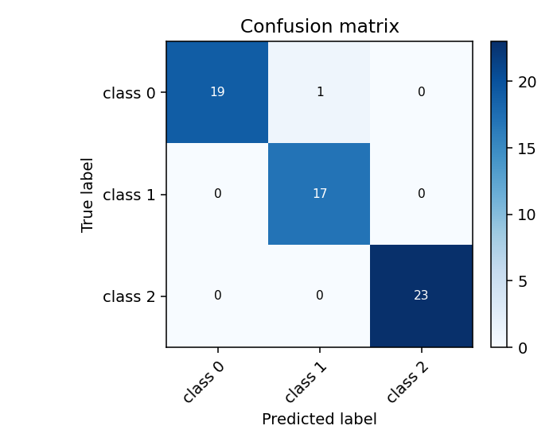

# Neural Network From Scratch

[](https://github.com/AhdyAhmed/Neural-Network-From-Scratch/actions/workflows/tests.yml)
[](https://www.python.org/downloads/)
[](LICENSE)

A small educational deep-learning library built with NumPy—no PyTorch,
TensorFlow, or autograd. Every forward pass, gradient, optimizer update, and
training control is implemented directly so the mechanics remain visible.

**Status:** All 14 implementation days are complete and the code is ready for
the `v0.1.0` release. The automated suite contains 527 passing tests when the
checksum-verified MNIST dataset is available.

## What is included

- Dense and inverted-dropout layers with explicit forward and backward passes
- ReLU, sigmoid, tanh, and numerically stable softmax activations
- MSE, binary cross-entropy, and categorical cross-entropy losses
- SGD, Momentum, RMSProp, and bias-corrected Adam
- Xavier/Glorot and He initialization plus L2 regularization
- Mini-batch training, reproducible shuffling, validation metrics, and early stopping
- Numerical gradient checking and activation/gradient diagnostics
- Confusion matrices, per-class accuracy, and plotting helpers
- Reproducible XOR, regression, multiclass, and MNIST experiments

## Install

Python 3.10 or newer is required.

```bash
git clone https://github.com/AhdyAhmed/Neural-Network-From-Scratch.git
cd Neural-Network-From-Scratch

python -m venv .venv
source .venv/bin/activate          # Windows PowerShell: .venv\Scripts\Activate.ps1
python -m pip install --upgrade pip
python -m pip install -e ".[dev]"
```

For runtime dependencies only, use `python -m pip install -r requirements.txt`.

## Quick start

This example learns `y = 2x + 1` with one dense layer:

```python
import numpy as np

from nn import Dense, MSE, SGD, Sequential

rng = np.random.default_rng(0)
x = rng.uniform(-1, 1, size=(100, 1))
y = 2 * x + 1

model = Sequential([Dense(1, 1, seed=0)])
model.compile(loss=MSE(), optimizer=SGD(lr=0.3))
history = model.fit(x, y, epochs=200, verbose=0)

print(model.predict([[0.5]]))  # approximately [[2.0]]
```

The same API supports multiclass classification:

```python
from nn import Adam, CategoricalCrossEntropy, Dense, ReLU, Sequential, Softmax

model = Sequential(
    [
        Dense(784, 128, initializer="he", seed=0),
        ReLU(),
        Dense(128, 10, initializer="xavier", seed=1),
        Softmax(),
    ]
)
model.compile(loss=CategoricalCrossEntropy(), optimizer=Adam(lr=1e-3))
```

## Verify and run

```bash
python -m pytest
python -m black --check nn examples tests

python examples/xor.py
python examples/regression.py
python examples/three_class_blobs.py
python examples/day12_analysis.py
python examples/day13_experiments.py --quick
```

The full Day 13 experiment downloads the verified MNIST file and writes its
configuration, histories, timings, and measurements to
`results/day13_experiments.json`:

```bash
python examples/day13_experiments.py
```

The test split is used only for the predeclared final configuration. Ablations
use validation data, and random seeds and hyperparameters are recorded. The
committed output was produced by a full run on the canonical
50,000/10,000/10,000 train/validation/test split.

## Reproduced results

| Experiment | Setup | Result |
|---|---|---|
| MNIST baseline | 784 → 128 → 64 → 10, SGD, 15 epochs | **97.62% test accuracy** |
| He + Momentum | Same architecture, 3 seeds, 10 epochs | **97.6 ± 0.1% validation accuracy** |
| Optimizer comparison | SGD, Momentum, RMSProp, Adam; 3 seeds | **97.65–97.77% final validation accuracy** |
| Early-stopping demo | Synthetic 3-class blobs, Adam | **98.33% validation accuracy**, stopped at epoch 23 |
| Final MNIST model | Adam, He init, 10% Dropout, early stopping | **97.81% held-out test accuracy**, 0.07313 test loss |

Raw measurements are stored in [`results/`](results/), including the full
[`results/day13_experiments.json`](results/day13_experiments.json) run. See the
accompanying notes for the protocol and interpretation; timing values are
machine-specific.





<details>
<summary>More experiment plots</summary>

### Linear regression



### XOR and sine regression





### Initialization through depth



### Regularization



### Early stopping and diagnostics





</details>

## Project layout

```text
nn/          Library code
tests/       Unit, integration, gradient, and regression tests
examples/    Runnable and reproducible experiments
notes/       Mathematical derivations and experiment write-ups
notebooks/   End-to-end walkthrough notebook
assets/      Generated plots used by the documentation
results/     Committed measured outputs
design.md    Architecture and design decisions
roadmap.md   Fourteen-day implementation plan
```

## Documentation

- [Architecture and design decisions](design.md)
- [Fourteen-day roadmap](roadmap.md)
- [Backpropagation derivation](notes/backprop.md)
- [Gradient checking](notes/day5_gradient_checking.md)
- [Initialization, Momentum, and diagnostics](notes/day9_init_and_momentum.md)
- [RMSProp, Adam, and optimizer comparison](notes/day10_rmsprop_and_adam.md)
- [L2 regularization and Dropout](notes/day11_regularization.md)
- [Early stopping, metrics, and visualization](notes/day12_early_stopping_metrics_visualization.md)
- [Reproducible experiments and results](notes/day13_experiments_and_results.md)
- [Documentation, CI, and release process](notes/day14_documentation_ci_release.md)
- [Release history](CHANGELOG.md)

## Design principles

- Gradients are derived and implemented manually.
- Numerical stability is part of correctness, not an optional optimization.
- Gradient checks validate the chain rule independently of training success.
- Experiments record seeds and configuration, and never select on the test set.
- Educational clarity takes priority over framework-scale performance.

## License

Released under the [MIT License](LICENSE).
